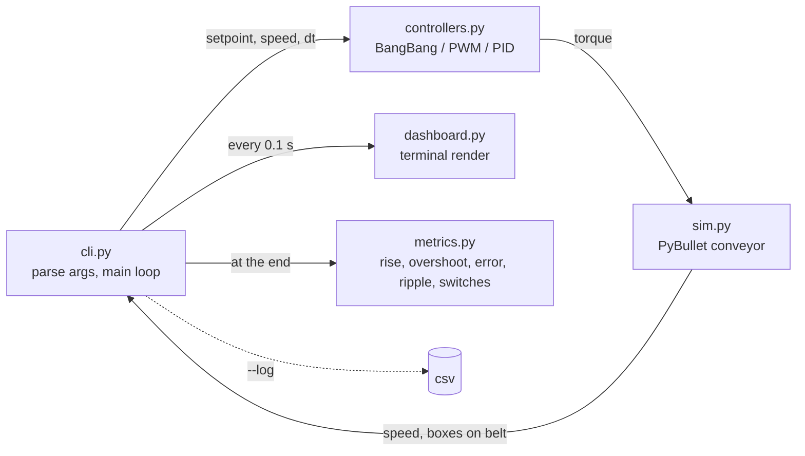
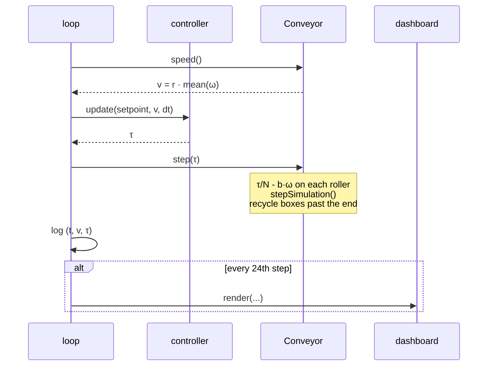

# Conveyor Motor Speed Control: Bang-Bang, PWM and PID

A small PyBullet simulation of a roller conveyor driven by a single motor, carrying load boxes, with three interchangeable speed controllers and a live command-line dashboard. The goal is to see, side by side, how bang-bang, PWM and PID control behave on the same physical plant under the same load.

Everything runs from one CLI command, `conveyor`, in either headless mode (dashboard only) or with the PyBullet 3D window.

## Contents

- [What it does](#what-it-does)
- [Setup](#setup)
- [Running](#running)
- [The dashboard](#the-dashboard)
- [Compare mode](#compare-mode)
- [The physical model](#the-physical-model)
- [The controllers](#the-controllers)
- [How the pieces fit](#how-the-pieces-fit)
- [Project layout](#project-layout)
- [Tuning](#tuning)
- [Troubleshooting](#troubleshooting)

## What it does

- Builds a conveyor out of 10 cylindrical rollers in PyBullet. All rollers are on one motor shaft, so one motor torque drives the whole belt.
- Drops load boxes onto the rollers. Friction between roller and box transports the boxes, and the same friction drags on the motor. When a box reaches the end it is put back at the start, so the load keeps changing.
- Measures belt speed as roller angular velocity times roller radius.
- Runs one of three controllers every simulation step to pick a motor torque that holds the belt at a setpoint speed.
- Shows a text dashboard in the terminal that refreshes 10 times per simulated second, and prints a summary of response metrics at the end.
- Can run all three controllers back to back and print the metrics in one place.

## Setup

Requirements:

- Python 3.10 or newer
- [uv](https://docs.astral.sh/uv/) for the virtual environment and dependencies
- A C and C++ compiler. PyBullet has no prebuilt wheel for most platforms and compiles from source on install, which takes a few minutes. On macOS install the Xcode command line tools (`xcode-select --install`). On Linux install `build-essential`.

Clone and install:

```sh
git clone https://github.com/yashdagar/conveyor-motor-speed-control.git
cd conveyor-motor-speed-control
uv sync
```

On macOS with a recent Xcode the PyBullet build fails inside its bundled zlib with `error: expected identifier or '('` in `_stdio.h`. The bundled `zutil.h` redefines `fdopen` as `NULL` on macOS and the current SDK headers reject that. Predefine the macro so the redefinition is skipped:

```sh
CFLAGS="-Dfdopen=fdopen" uv sync
```

Check the install:

```sh
uv run conveyor --help
```

## Running

The CLI takes one positional argument, the controller, followed by optional flags.

```sh
uv run conveyor pid
uv run conveyor bangbang
uv run conveyor pwm
uv run conveyor compare
```

With no arguments it runs `pid`.

Flags:

- **`--setpoint`** target belt speed in m/s. Default `0.5`. The motor tops out at about `1.0` m/s with no load, so setpoints near or above that cannot be reached.
- **`--duration`** simulated seconds to run. Default `15`.
- **`--boxes`** number of load boxes on the belt. Default `3`. Use `0` for an unloaded belt.
- **`--gui`** open the PyBullet 3D window next to the dashboard.
- **`--fast`** run the simulation as fast as the CPU allows instead of pacing it to wall-clock time. The dashboard still redraws but flies past. Useful when you only want the CSV log or the final metrics.
- **`--log FILE`** write a CSV with columns `time, setpoint, speed, torque` sampled every simulation step (240 Hz).

Examples:

```sh
uv run conveyor pid --gui
uv run conveyor bangbang --setpoint 0.3 --boxes 5
uv run conveyor pwm --duration 5 --fast --log pwm.csv
uv run conveyor compare --duration 10 --log compare.csv
```

Press Ctrl+C at any time. The run stops cleanly and the metrics for the part that ran are printed.

## The dashboard

The dashboard is plain text, redrawn in place with an ANSI clear every 0.1 simulated seconds. It uses nothing outside the standard library.

```
Conveyor Motor Speed Control   controller=pid   t=  3.20s

setpoint   0.500 m/s
speed      0.504 m/s  [####################..........]
error     -0.004 m/s
torque     2.110 N.m  [################..............]
duty      -
boxes     3 on belt

speed      ▂▃▄▄▄▄▄▅▅▅▅▅▅▅▅▅▅▅▅▅▅▅▅▅▅▅▅▅▅▅▅▅▅▅▅▅▅▅▅▅
          0 .. 0.75 m/s, last 40 samples

Ctrl+C to stop
```

Line by line:

- **setpoint** the target speed you asked for.
- **speed** measured belt speed, with a bar scaled from 0 to 1.5 times the setpoint so overshoot is visible.
- **error** setpoint minus speed. Positive means the belt is too slow.
- **torque** the motor torque the controller chose this step, with a bar from 0 to the 4 N.m motor limit. For bang-bang and PWM this is either 0 or full torque.
- **duty** PWM duty cycle. Only the PWM controller fills this in.
- **boxes** how many boxes are currently touching a roller. A box that has just been recycled to the start is briefly in the air and not counted.
- **speed sparkline** the last 40 dashboard samples (4 simulated seconds) of belt speed, so you can see ripple and settling without a plot.

When the run ends these metrics are printed:

- **rise_time_s** first time the speed reached 90 % of the setpoint, or `never`.
- **overshoot_pct** how far above the setpoint the peak speed went, as a percentage of the setpoint.
- **steady_state_error** mean of setpoint minus speed over the last 20 % of the run. Positive means the belt settled below the setpoint.
- **ripple** peak to peak speed variation over the last 20 % of the run.
- **mean_torque** average commanded torque over the whole run. A rough proxy for energy use.
- **switches** how many times the torque went between zero and non-zero. Counts actuator chatter. PID is continuous so this is normally 0.

## Compare mode

```sh
uv run conveyor compare
```

Runs bang-bang, PWM and PID in turn, headless and at full speed, on identical conveyors, then prints the metrics side by side. With `--log name.csv` it writes `name_bangbang.csv`, `name_pwm.csv` and `name_pid.csv`.

Typical output with the defaults:

```
setpoint 0.5 m/s

metric                      bangbang           pwm           pid
rise_time_s                   0.1375        0.1375        0.5125
overshoot_pct                 5.9375        4.5644        1.9891
steady_state_error           -0.0000        0.0521        0.0000
ripple                        0.0602        0.1636        0.0212
mean_torque                   2.1694        1.9306        2.1216
switches                         302           117             0
```

How to read it:

- Bang-bang and PWM slam full torque from the start, so they rise fastest. PID ramps torque with the error, so it is slower but overshoots least.
- Bang-bang has zero average error because it is always correcting, but it does that by switching the motor hundreds of times, which is the ripple you see.
- PWM here uses a proportional duty cycle, so it settles below the setpoint by a fixed offset. That offset is exactly the error needed to produce the duty cycle that balances the friction. Only an integral term can remove it, which is what PID adds.
- PID's remaining ripple is real load variation: boxes landing on and leaving the belt.

## The physical model

```
                 load boxes ride on the rollers, friction pulls them along +x
                 ┌──────┐          ┌──────┐          ┌──────┐
                 │      │          │      │          │      │
   belt speed v  │  1kg │          │  1kg │          │  1kg │   box past the end
   ───────────▶  └──────┘          └──────┘          └──────┘   is reset to x=0
     ( )  ( )  ( )  ( )  ( )  ( )  ( )  ( )  ( )  ( )
      0    1    2    3    4    5    6    7    8    9       10 rollers, r = 5 cm, 12 cm apart
      └────┴────┴────┴────┴────┴────┴────┴────┴────┘
                   one motor shaft, torque τ shared equally
```

Each roller is a 2 kg cylinder of radius 5 cm on a continuous revolute joint about the y axis. PyBullet's built-in joint motors are switched off and every step the simulation applies a raw torque to each roller:

```
τ_i = τ / N  -  b · ω_i
```

- `τ` is the motor torque the controller asked for, 0 to 4 N.m.
- `N = 10` rollers share it equally, which is what a single shaft through all rollers does.
- `b = 0.02 N.m.s/rad` is viscous friction in the bearings, applied explicitly so the motor model is visible in the code rather than hidden in URDF parameters.
- `ω_i` is the roller's angular velocity.

Belt speed is the average roller rim speed:

```
v = r · mean(ω_i)
```

With no boxes the belt behaves like a first-order system. The steady speed for a constant torque is `v = r · τ / (N · b)`, so 4 N.m gives 1.0 m/s and the 0.5 m/s default setpoint needs 2 N.m. The time constant is `J / b = 0.0025 / 0.02 ≈ 0.125 s` where `J = ½ m r²` is one roller's inertia.

The boxes are 20 cm cubes of 1 kg with friction coefficient 1.0 against the rollers. They start evenly spaced along the belt at rest. Each one has to be accelerated by roller friction, and that same friction force is a reaction torque on the rollers, so the boxes show up to the controller as a disturbance. Any box whose centre passes the last roller, or that falls below the rollers, is teleported back to the start with zero velocity. That is deliberately abrupt: it is the equivalent of a new box being dropped onto a running belt.

The simulation steps at 240 Hz and the controller runs at the same rate. Everything in the `Conveyor` constructor (roller count, radius, spacing, masses, friction) is a keyword argument if you want to change the plant.

## The controllers

All three share one interface: `update(setpoint, speed, dt)` returns a torque in `[0, 4]` N.m. The CLI calls it once per step and hands the result to the simulation. Nothing else differs between runs.

### Bang-bang

```
if speed < setpoint - band:  motor on  (full torque)
if speed > setpoint + band:  motor off (zero torque)
otherwise:                   keep the previous state
```

- `band = 0.02 m/s` is the hysteresis half-width. Without it the motor would toggle every single step around the setpoint.
- The belt speed oscillates between the two edges of the band at whatever frequency the plant dynamics allow. Average error is zero, but the motor is never resting and the switching count is in the hundreds.
- This is the simplest thing that works, the equivalent of a thermostat.

### PWM

```
every period (1/10 s):  duty = clamp(kp · (setpoint - speed), 0, 1)
within the period:       motor on for duty · period, then off
```

- `kp = 4` per m/s. An error of 0.25 m/s means 100 % duty.
- Carrier frequency is 10 Hz, chosen low enough that the on/off pulses are visible on the dashboard and in the ripple metric. Real motor drivers use kilohertz carriers, where the mechanical inertia smooths the ripple away.
- The duty cycle is sampled once at the start of each period and held, which is how a hardware PWM timer behaves.
- Because duty is proportional to error, a non-zero error is required to hold any non-zero duty. The belt therefore settles below the setpoint. With the defaults the balance point needs roughly 50 % duty, which at `kp = 4` means an error of about 0.13 m/s at the moment the duty is sampled. That sample is taken at the end of the off phase, the lowest point of the speed ripple, so the error averaged over a whole period is smaller, about 0.05 m/s in the compare table.

### PID

```
error     = setpoint - speed
integral  = clamp(integral + error · dt, -limit, +limit)
derivative = (error - previous error) / dt
torque    = clamp(kp · error + ki · integral + kd · derivative, 0, 4)
```

- `kp = 6`, `ki = 20`, `kd = 0.05`.
- The integral is clamped to `±4 / ki` so that it can never ask for more than full torque on its own. This is anti-windup: without it the integral would keep growing while the motor was saturated during the initial ramp and cause a large overshoot.
- The derivative uses the raw error difference. There is no filtering, which is fine here because the speed measurement comes straight from the physics engine with no sensor noise.
- Output is continuous, so the motor never switches off, ripple is lowest, and the integral term removes the offset PWM is stuck with.

## How the pieces fit



One iteration of the loop in `cli.py`:



Control signal flow as a classic block diagram:

```
 setpoint ──▶(+)──▶ controller ──▶ motor torque τ ──▶ rollers + boxes ──▶ belt speed v
              ▲                                                               │
              │ -                                                             │
              └───────────────────────────────────────────────────────────────┘
```

## Project layout

```
conveyor-motor-speed-control/
├── pyproject.toml          package metadata, the `conveyor` entry point
├── README.md
└── conveyor/
    ├── cli.py              argument parsing, simulation loop, compare mode, CSV output
    ├── sim.py              builds the roller URDF, wraps PyBullet, applies torque, recycles boxes
    ├── controllers.py      BangBang, PWM, PID and the CONTROLLERS registry
    ├── dashboard.py        bar, sparkline and the render() call that redraws the terminal
    └── metrics.py          summarize() that turns a run log into the metric dict
```

- **`sim.py`** generates the URDF as a string at startup and writes it to the system temp directory, so there is no checked-in robot file to keep in sync with the parameters. `MAX_TORQUE` and the timestep `DT` live here because they describe the motor, not the controller.
- **`controllers.py`** has no PyBullet dependency. Each controller is a plain class with a bit of state, so they could be reused against a real motor driver.
- **`cli.py`** is the only place that knows about all the other modules.

## Tuning

The constants are in the code rather than behind flags, on purpose, to keep the CLI small. Where to look:

- **Setpoint reachability** `MAX_TORQUE` in `sim.py` and `damping` in the `Conveyor` constructor set the top speed, `r · MAX_TORQUE / (N · damping)`.
- **Bang-bang chatter** `band` in `BangBang`. Wider band means fewer switches and more ripple.
- **PWM** `kp` sets how hard it reacts and therefore the steady-state offset, `hz` sets the carrier. At 240 Hz simulation a 10 Hz carrier gives 24 steps per period, so duty resolution is about 4 %. Raising `hz` reduces visible ripple but coarsens the duty resolution.
- **PID** start from `kp`, add `ki` until the offset is gone, then a small `kd` if overshoot appears. The anti-windup limit follows `ki` automatically.
- **Load** `--boxes` from the CLI, `box_mass` and `box_size` in the constructor. Heavier or more boxes mean a larger disturbance every recycle and a slower rise.

Use `--log` and `compare` together to check a change numerically rather than by eye.

## Troubleshooting

- **PyBullet fails to build on macOS** with an error in `_stdio.h` or `zutil.h`: run `CFLAGS="-Dfdopen=fdopen" uv sync` as described under Setup.
- **`--gui` opens nothing or crashes on a remote or headless machine**: the GUI needs a display. Drop the flag and use the dashboard, the physics are identical.
- **Dashboard flickers or shows stacked copies**: the terminal does not understand ANSI clear sequences. Any modern terminal (Terminal.app, iTerm, WezTerm, most Linux terminals) works.
- **Speed never reaches the setpoint**: the setpoint is above the motor's top speed for the current load. Lower it or raise `MAX_TORQUE`.
- **Boxes bounce or fall off**: they are 20 cm cubes on rollers 12 cm apart, so each box always rests on at least two rollers. If you change the geometry keep `box_size` larger than `spacing`.
