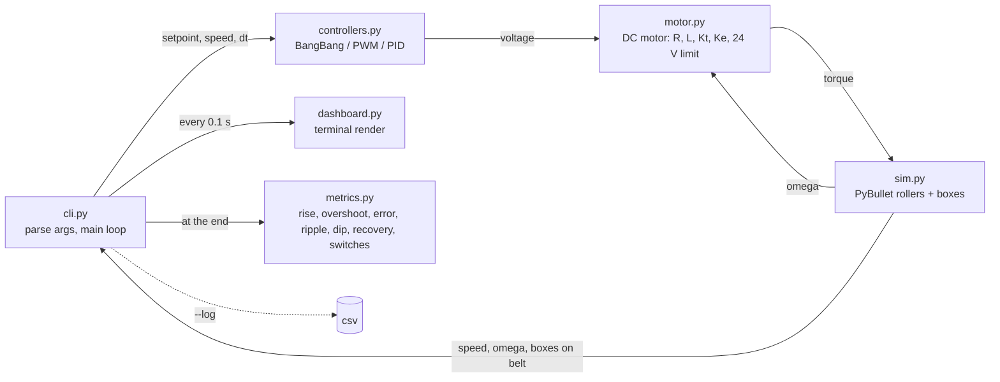
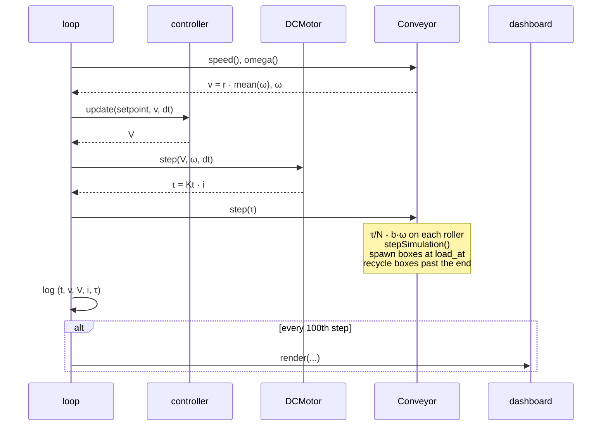

# Conveyor Motor Speed Control: Bang-Bang, PWM and PID

A PyBullet simulation of a DC motor driving a roller conveyor that carries load boxes, with three interchangeable speed controllers and a live command-line dashboard. The point is to see, on one physical plant and under the same load changes and actuator saturation, how bang-bang, PWM and PID control behave.

Everything runs from one CLI command, `conveyor`, headless (dashboard only) or with the PyBullet 3D window.

## Contents

- [Project context](#project-context)
- [What it does](#what-it-does)
- [Setup](#setup)
- [Running](#running)
- [The dashboard](#the-dashboard)
- [Compare mode and metrics](#compare-mode-and-metrics)
- [The physical model](#the-physical-model)
- [The controllers](#the-controllers)
- [How the pieces fit](#how-the-pieces-fit)
- [Project layout](#project-layout)
- [Report and figures](#report-and-figures)
- [Tuning](#tuning)
- [Troubleshooting](#troubleshooting)

## Project context

- **Course** CSAI4014 Algorithms for Intelligent Systems and Robotics, B.Tech CSE (AI & ML), Semester VII, UPES Dehradun.
- **Project** P15, Group G07, Batch B1.
- **Problem statement** Model a DC motor driving a conveyor, compare bang-bang, PWM and PID control under load changes and actuator saturation, and run it from a Python command-line dashboard.
- **Syllabus topics** Time and Frequency Domain, Constraints, Control Actuation, Stability.
- **Platform** PyBullet (conveyor belt and motor joint with load boxes), Python + command-line dashboard.
- **Industry link** Conveyor drives, EV and industrial motor control.
- **Members** Amulya Jain (500122439), Aasthik Upadhyay (500123174), Krish Manwani (500123449), Vanshaj Tiwari (500123258), Yash Dagar (500125147).

The written report lives in `report/` and is built from the same code and figures, see [Report and figures](#report-and-figures).

## What it does

- Builds a conveyor out of 10 cylindrical rollers in PyBullet, all on one shaft, so one motor drives the whole belt.
- Models the motor as a brushed DC machine: the controller commands a voltage, the armature circuit turns it into current and torque, back-EMF rises with speed, and the supply is limited to 24 V. That limit is the actuator saturation.
- Drops load boxes onto the rollers, either at the start or at a chosen second. Friction between roller and box transports the boxes, and the same friction is a load torque on the motor. When a box reaches the end it is put back at the start, so the load keeps changing.
- Measures belt speed as roller angular velocity times roller radius.
- Runs one of three controllers every simulation step to pick a motor voltage that holds the belt at a setpoint speed.
- Shows a text dashboard in the terminal that refreshes 10 times per simulated second, and prints a summary of response metrics at the end.
- Can run all three controllers back to back on the same scenario and print the metrics in one place.

## Setup

Requirements:

- Python 3.10 or newer
- [uv](https://docs.astral.sh/uv/) for the virtual environment and dependencies
- A C and C++ compiler. PyBullet has no prebuilt wheel for most platforms and compiles from source on install, which takes a few minutes. On macOS install the Xcode command line tools (`xcode-select --install`). On Linux install `build-essential`.

Clone:

```sh
git clone https://github.com/yashdagar/conveyor-motor-speed-control.git
cd conveyor-motor-speed-control
```

Install on Windows:

```powershell
uv sync
```

Install on macOS:

```sh
CFLAGS="-Dfdopen=fdopen" uv sync
```

Check the install:

```sh
uv run conveyor --help
```

## Running

The CLI takes one positional argument, the controller, followed by optional flags.

```sh
uv run conveyor pid
uv run conveyor bangbang
uv run conveyor pwm
uv run conveyor compare
```

With no arguments it runs `pid`.

Flags:

- **`--setpoint`** target belt speed in m/s. Default `0.5`. The motor tops out at about `0.92` m/s with no load, so setpoints above that cannot be reached and the voltage stays pinned at 24 V.
- **`--duration`** simulated seconds to run. Default `15`.
- **`--boxes`** number of load boxes. Default `3`. Use `0` for an unloaded belt.
- **`--load-at`** the simulated second at which the boxes are dropped onto the belt. Default `0`, meaning they are there from the start. Set it to, say, `5` to let the controller settle first and then hit it with a load change.
- **`--gui`** open the PyBullet 3D window next to the dashboard.
- **`--fast`** run the simulation as fast as the CPU allows instead of pacing it to wall-clock time. The dashboard still redraws but flies past. Useful when you only want the CSV log or the final metrics.
- **`--log FILE`** write a CSV with columns `time, setpoint, speed, voltage, current, torque` sampled every simulation step (1 kHz).

Examples:

```sh
uv run conveyor pid --gui
uv run conveyor bangbang --setpoint 0.3 --boxes 5
uv run conveyor pwm --duration 5 --fast --log pwm.csv
uv run conveyor pid --load-at 5 --duration 10
uv run conveyor compare --duration 10 --load-at 5 --log compare.csv
```

Press Ctrl+C at any time. The run stops cleanly and the metrics for the part that ran are printed.

## The dashboard

The dashboard is plain text, redrawn in place with an ANSI clear every 0.1 simulated seconds. It uses nothing outside the standard library.

```
Conveyor Motor Speed Control   controller=pid   t=  3.20s

setpoint   0.500 m/s
speed      0.504 m/s  [####################..........]
error     -0.004 m/s
voltage    13.21 V    [################..............]
current     4.12 A
torque      2.06 N.m
duty      -
boxes     3 on belt

speed      ▂▃▄▄▄▄▄▅▅▅▅▅▅▅▅▅▅▅▅▅▅▅▅▅▅▅▅▅▅▅▅▅▅▅▅▅▅▅▅▅
          0 .. 0.75 m/s, last 40 samples

Ctrl+C to stop
```

Line by line:

- **setpoint** the target speed you asked for.
- **speed** measured belt speed, with a bar scaled from 0 to 1.5 times the setpoint so overshoot is visible.
- **error** setpoint minus speed. Positive means the belt is too slow.
- **voltage** the motor voltage the controller chose this step, with a bar from 0 to the 24 V supply. For bang-bang and PWM this is either 0 or 24 V.
- **current** armature current from the motor model. It lags the voltage because of the winding inductance, and goes negative when the motor is braking.
- **torque** motor torque, current times the torque constant.
- **duty** PWM duty cycle. Only the PWM controller fills this in.
- **boxes** how many boxes are currently touching a roller. A box that has just been recycled to the start is briefly in the air and not counted.
- **speed sparkline** the last 40 dashboard samples (4 simulated seconds) of belt speed, so you can see ripple and settling without a plot.

## Compare mode and metrics

```sh
uv run conveyor compare --duration 10 --load-at 5
```

Runs bang-bang, PWM and PID in turn, headless and at full speed, on identical conveyors, then prints the metrics side by side. With `--log name.csv` it writes `name_bangbang.csv`, `name_pwm.csv` and `name_pid.csv`.

Output for the command above:

```
setpoint 0.5 m/s, 3 boxes at t=5.0s

metric                      bangbang           pwm           pid
rise_time_s                   0.0600        0.0640        0.5160
overshoot_pct                 6.9853        0.0000        2.3175
steady_state_error            0.0031        0.1013        0.0004
ripple                        0.0685        0.0348        0.0244
load_dip                      0.0883        0.1583        0.0637
recovery_s                         -             -        0.1230
mean_voltage                 13.2960       10.6968       13.1699
switches                         456           995             0
```

The metrics, also printed after every single-controller run:

- **rise_time_s** first time the speed reached 90 % of the setpoint, or `-` if it never did.
- **overshoot_pct** how far above the setpoint the peak speed went, as a percentage of the setpoint.
- **steady_state_error** mean of setpoint minus speed over the last 20 % of the run. Positive means the belt settled below the setpoint.
- **ripple** peak to peak speed variation over the last 20 % of the run.
- **load_dip** how far the speed fell below the setpoint after the boxes landed. Only computed when `--load-at` is non-zero.
- **recovery_s** seconds after the load change until the speed stayed within 0.02 m/s of the setpoint for 0.2 s. `-` means it never settled inside that band, which is normal for the switching controllers because their ripple is wider than the band.
- **mean_voltage** average commanded voltage over the whole run. A rough proxy for energy use.
- **switches** how many times the voltage went between zero and non-zero. Counts actuator chatter. PID is continuous so this is 0.

How to read the table:

- Bang-bang and PWM slam 24 V from the start, so they rise fastest. PID ramps the voltage with the error, so it is slower but overshoots least.
- Bang-bang has almost zero average error because it is always correcting, but it does that by switching the motor about 46 times a second, which is the ripple you see.
- PWM here uses a proportional duty cycle, so it settles below the setpoint by a fixed offset. That offset is exactly the error needed to produce the duty cycle that balances friction and load. Only an integral term can remove it, which is what PID adds.
- When the boxes land, PID dips least and is back inside the band in about an eighth of a second. PWM dips most because its proportional law needs a bigger error before it raises the duty.
- PID's remaining ripple is real load variation: boxes landing on and leaving the belt.

## The physical model

```
                 load boxes ride on the rollers, friction pulls them along +x
                 ┌──────┐          ┌──────┐          ┌──────┐
                 │      │          │      │          │      │
   belt speed v  │  1kg │          │  1kg │          │  1kg │   box past the end
   ───────────▶  └──────┘          └──────┘          └──────┘   is reset to x=0
     ( )  ( )  ( )  ( )  ( )  ( )  ( )  ( )  ( )  ( )
      0    1    2    3    4    5    6    7    8    9       10 rollers, r = 5 cm, 12 cm apart
      └────┴────┴────┴────┴────┴────┴────┴────┴────┘
                   one shaft, motor torque τ shared equally
                              │
                   ┌──────────┴──────────┐
                   │   DC motor          │   V  ──▶ R, L, back-EMF Ke·ω ──▶ i ──▶ τ = Kt·i
                   └─────────────────────┘
```

### Motor

The motor is a brushed DC machine with the usual armature equation. The controller sets the terminal voltage `V`, clamped to `0 .. 24 V`. Every step:

```
di/dt = (V - R·i - Ke·ω) / L
τ     = Kt · i
```

- `R = 2 Ω` armature resistance, `L = 0.02 H` armature inductance, so the electrical time constant is 10 ms.
- `Kt = 0.5 N.m/A` torque constant, `Ke = 0.5 V.s/rad` back-EMF constant.
- Stall torque at 24 V is 6 N.m, no-load speed is 48 rad/s.
- With `V = 0` the model behaves like a shorted armature, so the back-EMF drives a negative current and the motor brakes. That is why the current trace goes negative during the off phases of bang-bang and PWM.

The electrical equation is integrated with explicit Euler at the simulation step of 1 ms, which is well inside the 10 ms electrical time constant.

### Rollers

Each roller is a 2 kg cylinder of radius 5 cm on a continuous revolute joint about the y axis. PyBullet's built-in joint motors are switched off and every step the simulation applies a raw torque to each roller:

```
τ_i = τ / N  -  b · ω_i
```

- `τ` is the motor torque from the equation above.
- `N = 10` rollers share it equally, which is what a single shaft through all rollers does.
- `b = 0.02 N.m.s/rad` per roller is viscous friction in the bearings, applied explicitly so the model is visible in the code rather than hidden in URDF parameters.
- `ω_i` is the roller's angular velocity.

Belt speed is the average roller rim speed:

```
v = r · mean(ω_i)
```

The roller inertia comes from the URDF (`J = ½ m r² = 0.0025 kg.m²` each). PyBullet ignores URDF inertia by default and recomputes it from the collision shape, which gave a 50 % heavier roller, so the loader is called with the flag that trusts the file.

### Linear model

With no boxes the whole thing is a linear second-order system from voltage to belt speed:

```
G(s) = r · Kt / ( (L s + R)(J s + B) + Kt Ke )
```

with `J = 0.025 kg.m²` and `B = 0.2 N.m.s/rad` for all ten rollers together. Its DC gain is 0.0385 m/s per volt, so 24 V gives 0.923 m/s, and the mechanical pole sits at 8 rad/s and the electrical pole at 100 rad/s. The open-loop step in PyBullet matches this model: final speed 0.9231 vs 0.9231 m/s and a time constant of 79 ms vs 77 ms. That check is one of the report figures.

### Load boxes

The boxes are 20 cm cubes of 1 kg with friction coefficient 1.0 against the rollers. They are spawned evenly spaced along the belt at rest, either at `t = 0` or at `--load-at`. Each one has to be accelerated by roller friction, and that same friction force is a reaction torque on the rollers, so the boxes show up to the controller as a disturbance. Any box whose centre passes the last roller, or that falls below the rollers, is teleported back to the start with zero velocity. That is deliberately abrupt: it is the equivalent of a new box being dropped onto a running belt.

The simulation steps at 1 kHz and the controller runs at the same rate. Everything in the `Conveyor` constructor (roller count, radius, spacing, masses, friction) and the `DCMotor` constructor is a keyword argument if you want to change the plant.

## The controllers

All three share one interface: `update(setpoint, speed, dt)` returns a voltage in `[0, 24]` V. The CLI calls it once per step, feeds the voltage to the motor model, and hands the resulting torque to the simulation. Nothing else differs between runs.

### Bang-bang

```
if speed < setpoint - band:  full voltage
if speed > setpoint + band:  zero voltage
otherwise:                   keep the previous state
```

- `band = 0.02 m/s` is the hysteresis half-width. Without it the motor would toggle every single step around the setpoint.
- The belt speed oscillates between the two edges of the band at whatever frequency the plant dynamics allow, here about 46 Hz. Average error is near zero, but the motor is never resting.
- This is the simplest thing that works, the equivalent of a thermostat.

### PWM

```
every carrier period (1/50 s):  duty = clamp(kp · (setpoint - speed), 0, 1)
within the period:              full voltage for duty · period, then zero
```

- `kp = 4` per m/s. An error of 0.25 m/s means 100 % duty.
- The carrier is 50 Hz, which is 20 simulation steps per period, so the duty resolution is 5 %. Real motor drivers use kilohertz carriers, where the inductance smooths the current completely. 50 Hz is slow enough that you can still see the pulses in the switching figure.
- The duty cycle is sampled once at the start of each period and held, which is how a hardware PWM timer behaves.
- Because duty is proportional to error, a non-zero error is required to hold any non-zero duty. The belt therefore settles below the setpoint, by about 0.10 m/s with three boxes.

### PID

```
error      = setpoint - speed
integral   = clamp(integral + error · dt, 0, 24 / ki)
derivative = (error - previous error) / dt
voltage    = clamp(kp · error + ki · integral + kd · derivative, 0, 24)
```

- `kp = 40 V per m/s`, `ki = 150`, `kd = 0.5`.
- The integral is clamped so that it can never ask for more than the full 24 V on its own. This is anti-windup. Without it the integral keeps growing while the output is saturated, and after a setpoint drop the voltage stays pinned long after it should have fallen. The report has a figure where an unreachable setpoint winds the integrator up for 3 s and the unclamped version then takes 3 s instead of 0.6 s to come down.
- The derivative uses the raw error difference. There is no filtering, which is fine here because the speed measurement comes straight from the physics engine with no sensor noise.
- Output is continuous, so the motor never switches off, ripple is lowest, and the integral term removes the offset PWM is stuck with.

## How the pieces fit



One iteration of the loop in `cli.py`:



Control signal flow as a classic block diagram:

```
 setpoint ──▶(+)──▶ controller ──▶ V (0..24 V) ──▶ DC motor ──▶ τ ──▶ rollers + boxes ──▶ belt speed v
              ▲                                       ▲                                        │
              │ -                                     └──────── back-EMF Ke·ω ◀────────────────┤
              └────────────────────────────────────────────────────────────────────────────────┘
```

## Project layout

```
conveyor-motor-speed-control/
├── pyproject.toml          package metadata, the `conveyor` entry point, the `report` dependency group
├── README.md
├── conveyor/
│   ├── cli.py              argument parsing, simulation loop, compare mode, CSV output
│   ├── sim.py              builds the roller URDF, wraps PyBullet, applies torque, spawns and recycles boxes
│   ├── motor.py            DC motor model, voltage in, torque out
│   ├── controllers.py      BangBang, PWM, PID and the CONTROLLERS registry
│   ├── dashboard.py        bar, sparkline and the render() call that redraws the terminal
│   └── metrics.py          summarize() that turns a run log into the metric dict
└── report/
    ├── figures.py          runs every experiment in the report and writes the PNGs
    ├── figures/            generated plots and the PyBullet screenshot
    └── report.tex          the project report, built with tectonic
```

- **`sim.py`** generates the URDF as a string at startup and writes it to the system temp directory, so there is no checked-in robot file to keep in sync with the parameters. The timestep `DT` lives here.
- **`motor.py`** is the one place the actuator limit (24 V) is defined. The controllers read it from the motor instance.
- **`controllers.py`** has no PyBullet dependency. Each controller is a plain class with a bit of state, so they could be reused against a real motor driver.
- **`cli.py`** is the only place that knows about all the other modules.

## Report and figures

The figures used in the report are generated, not drawn by hand. Install the extra dependency group and run the script:

Windows:

```powershell
uv sync --group report
uv run python report/figures.py
```

macOS:

```sh
CFLAGS="-Dfdopen=fdopen" uv sync --group report
uv run python report/figures.py
```

It takes about half a minute and writes to `report/figures/`:

- **step.png** the three controllers stepping to 0.5 m/s with 3 boxes on the belt: speed, 0.1 s mean voltage, 0.1 s mean current.
- **load.png** the same with the boxes dropped at 5 s.
- **switching.png** a 0.2 s window showing the raw bang-bang and PWM pulses, the current ripple they cause, and the resulting speed ripple.
- **saturation.png** PID at setpoints 0.5, 0.8 and 1.1 m/s. The last one is above the motor's top speed, so the voltage sits at 24 V and the error never closes.
- **windup.png** PID with and without the integral clamp, driven into saturation by an unreachable setpoint and then asked to come down.
- **tuning.png** three PID gain sets on the same step.
- **openloop.png** the PyBullet plant against the analytical linear model for a 24 V step.
- **bode.png** magnitude and phase of the voltage-to-speed transfer function.
- **pybullet.png** a rendered view of the conveyor and boxes.

The script also prints every metric that appears in the report's tables, so the numbers in the report can be regenerated from scratch.

Build the PDF:

```sh
cd report
tectonic -X compile report.tex
```

## Tuning

The plant and controller constants are in the code rather than behind flags, on purpose, to keep the CLI small. Where to look:

- **Setpoint reachability** the 24 V limit and `R`, `Ke` in `DCMotor`, and `damping` in `Conveyor`, set the top speed, `r · Kt · V / (R · B + Kt · Ke)`.
- **Bang-bang chatter** `band` in `BangBang`. Wider band means fewer switches and more ripple.
- **PWM** `kp` sets how hard it reacts and therefore the steady-state offset, `hz` sets the carrier. At 1 kHz simulation a 50 Hz carrier gives 20 steps per period, so duty resolution is 5 %. Raising `hz` reduces visible ripple but coarsens the duty resolution.
- **PID** start from `kp`, add `ki` until the offset is gone, then a small `kd` if overshoot appears. The anti-windup limit follows `ki` automatically. The tuning figure shows a slow set, the default and an aggressive set.
- **Load** `--boxes` and `--load-at` from the CLI, `box_mass` and `box_size` in the constructor. Heavier or more boxes mean a larger disturbance every recycle and a slower rise.

Use `--log` and `compare` together to check a change numerically rather than by eye.

## Troubleshooting

- **PyBullet fails to build on macOS**: use the macOS install command under Setup, not plain `uv sync`.
- **`--gui` opens nothing or crashes on a remote or headless machine**: the GUI needs a display. Drop the flag and use the dashboard, the physics are identical.
- **Dashboard flickers or shows stacked copies**: the terminal does not understand ANSI clear sequences. Any modern terminal (Terminal.app, iTerm, WezTerm, most Linux terminals) works.
- **Speed never reaches the setpoint**: the setpoint is above the motor's top speed for the current load, about 0.92 m/s unloaded. Lower it.
- **Boxes bounce or fall off**: they are 20 cm cubes on rollers 12 cm apart, so each box always rests on at least two rollers. If you change the geometry keep `box_size` larger than `spacing`.
